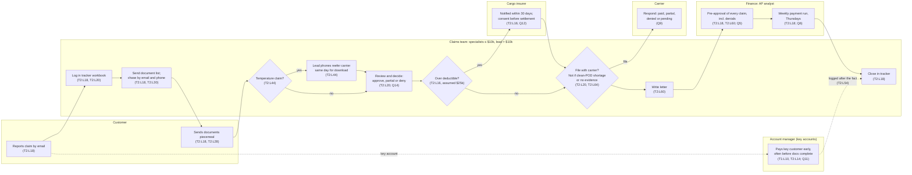

# Current-State Swimlane: Damage and Shortage Claims (draft)

> Fictional engagement for portfolio purposes. The client, stakeholders and data are synthetic.

Claude's draft from T1, T2 and release 1, for the consultant to correct. Each
step cites its source. Elapsed times are in `analysis/results.md` (Q4–Q6,
Q12); none are written here.

## Notes and open points

- **Order of steps after the decision** follows the claims lead's walkthrough
  (T2:L18): file with carrier, then pre-approval, then the payment run. The
  carrier step may run in parallel with pre-approval; not confirmed.
- **Insurer step position** is inferred from T2:L16 and T2:L48. Whether
  notification happens before or after the decision is not stated.
- **Account-manager path** bypasses review, pre-approval timing and carrier
  filing as described (T2:L14, T2:L54). Whether it goes through finance
  pre-approval is not stated.
- **Not recorded in the tracker:** document chasing (T2:L22), reefer calls
  (T2:L74), and AM payments until after the fact (T2:L54, T2:L74).
- **Escalation** is by value plus informal "walk over and ask" (T2:L40); not
  drawn as a separate step.
- **Loss claims** run through the same process (T2:L50) and are out of scope
  pending the consultant's ruling.
