# Current-State Swimlane: Damage, Shortage and Loss Claims

> Fictional engagement for portfolio purposes. The client, stakeholders and data are synthetic.

The process as it runs today, drawn from T1, T2 and release 1. Claude's draft
was corrected after consultant review on 2026-10-18: edits 1–25 were applied
except 11 and 14 (see `docs/consultant-decisions.md`). No redesign ruling
appears in this diagram. Every step cites its source. Stage waits on the
edges are Q4 medians and p90s from `analysis/results.md`.

System tags: `[tracker]` = claims tracker workbook, `[email]` = email,
`[phone]` = phone.

```mermaid
flowchart LR
    subgraph CUS["Customer"]
        C1["Reports claim by email<br/>damage, shortage or loss<br/>[email] (T2:L18, T2:L50)"]
        C2["Sends documents piecemeal<br/>[email] (T2:L18, T2:L28)"]
        C3["Withdraws claim<br/>(T2:L70)"]
        C4["Receives letter;<br/>paid if approved or partial<br/>(T2:L18, T2:L60)"]
    end

    subgraph AM["Account manager (key accounts, outside claims process)"]
        A1["Pays key customer early,<br/>often before docs complete<br/>(T1:L10, T2:L14, T2:L52; Q11)"]
    end

    subgraph CT["Claims team, shared steps: specialist ≤ $10k, lead > $10k (T2:L20)"]
        H1["Log claim in tracker<br/>[tracker] (T2:L18)"]
        H2{"Temperature / reefer claim?<br/>(T2:L44)"}
        H3["Send document list: photos,<br/>invoice, BOL, delivery receipt<br/>[email] (T2:L18)"]
        H4{"All documents in?<br/>(T2:L28, T2:L30)"}
        H5["Chase by email and phone;<br/>lives in inboxes, not tracker<br/>[email] [phone] (T2:L22, T2:L30)"]
        H6["Record docs-complete date<br/>[tracker] (T2:L22)"]
        H7["No written stop point:<br/>decide on what we have<br/>(T2:L34; Q13)"]
        H8{"Amount > $10k?<br/>(T2:L14, T2:L62)"}
        H21{"Approved or partial?<br/>(T2:L20; Q14)"}
        H9{"Shortage with clean POD?<br/>(T2:L20, T2:L64)"}
        H10["Pay customer if shortage<br/>checks out; do not file<br/>(T2:L20, T2:L64)"]
        H11{"Photos / delivery receipt<br/>on file?<br/>(T2:L30, T2:L64)"}
        H12["Nothing to file<br/>(T2:L30, T2:L64)"]
        H13["File with carrier<br/>[email] (T2:L18, T2:L20, T2:L64)"]
        H14["Draft letter,<br/>held until pre-approval<br/>(T2:L18, T2:L60)"]
        H20{"Denied?<br/>(T2:L18, T2:L60)"}
        H15["Send denial letter<br/>(T2:L60)"]
        H16["Send letter after payment<br/>(T2:L18)"]
        H17["Close in tracker<br/>[tracker] (T2:L18)"]
        H18["Close in tracker, no withdrawal<br/>code, maybe a note<br/>[tracker] (T2:L70)"]
        H19["Log AM payment after the fact<br/>[tracker] (T2:L54, T2:L74)"]
    end

    subgraph SP["Claims specialist"]
        S1["Review and decide (≤ $10k):<br/>approve, partial or deny<br/>(T2:L14, T2:L20; Q14)"]
    end

    subgraph LD["Claims lead"]
        L1["Review and decide (> $10k):<br/>approve, partial or deny<br/>(T2:L14, T2:L48, T2:L62)"]
        L2["Phone reefer carrier dispatcher<br/>same day; not in tracker<br/>[phone] (T2:L44, T2:L74)"]
        L3{"Over deductible?<br/>(T2:L16, assumed $25k)"}
        L4["Notify insurer within 30 days;<br/>await consent before settling<br/>(T2:L16, T2:L48, T2:L62; Q12)<br/>actor inferred from T2:L48"]
    end

    subgraph RD["Reefer carrier dispatcher"]
        D1["Provides temperature download;<br/>kept ~72h after delivery;<br/>if missed, carrier claim dies<br/>(T2:L44)"]
    end

    subgraph AP["AP analyst (finance)"]
        F1["Pre-approval of every claim,<br/>any amount, incl. denials;<br/>checks unknown to claims team<br/>(T2:L18, T2:L22, T2:L54, T2:L56, T2:L60; Q5)"]
    end

    subgraph PR["Finance payment run"]
        P1["Weekly payment run,<br/>Thursdays<br/>(T2:L18; Q6)"]
    end

    subgraph CAR["Carrier"]
        R1["Respond: paid, partial,<br/>denied or pending<br/>(Q9)"]
    end

    subgraph INS["Cargo insurer"]
        I1["Receives notice;<br/>consents before settlement<br/>(T2:L16, T2:L48; Q12)"]
    end

    C1 --> H1 --> H2
    H2 -- yes --> L2 -. same day .-> D1
    L2 --> H3
    H2 -- no --> H3
    H3 --> C2 --> H4
    H4 -- no --> H5 --> C2
    H4 -- "no, chasing stops" --> H7
    H4 -- "yes · Q4 received → docs complete: median 4d, p90 14d" --> H6
    H6 -- "Q4 docs complete → decision: median 3d, p90 4d" --> H8
    H7 --> H8
    H8 -- no --> S1
    H8 -- yes --> L1
    S1 -. "doesn't look right: walk over and ask; not recorded, tracker shows handler only (T2:L40)" .-> L1
    S1 --> H21
    L1 --> L3
    L3 -- yes --> L4 --> I1 --> H21
    L3 -- no --> H21
    H21 -- yes --> H9
    H21 -- "no (denied)" --> H14
    H9 -- yes --> H10 --> H14
    H9 -- no --> H11
    H11 -- no --> H12 --> H14
    H11 -- yes --> H13
    H13 --> R1
    H13 --> H14
    H14 -- "Q4 decision → pre-approval: median 14d, p90 27d" --> F1
    F1 --> H20
    H20 -- yes --> H15 --> H17
    H15 --> C4
    H20 -- no --> P1
    P1 -- "Q4 pre-approval → paid: median 4d, p90 7d" --> H16
    H16 -- "Q4 paid → closed: median 0d, p90 0d" --> H17
    H16 --> C4
    C3 --> H18
    C1 -. key account .-> A1
    A1 -. "claims team learns after the money's gone (T2:L54)" .-> H19
```

## Notes and open points

- **Lane structure.** Intake, chasing, filing, letters and closing are done by
  whoever owns the claim: a specialist up to $10k, the lead above (T2:L20).
  They sit in a shared claims-team block. The decision itself is drawn in
  separate specialist and lead lanes (T2:L14, T2:L62).
- **Stage waits** are elapsed time only. The event log has one date per step,
  so work and waiting cannot be separated within a stage (Q4 footnote). The
  decision → pre-approval wait includes carrier filing.
- **Order of steps after the decision** follows the claims lead's walkthrough
  (T2:L18): file with carrier, then pre-approval, then the payment run. The
  carrier step may run in parallel with pre-approval; not confirmed.
- **Insurer step position** is inferred from T2:L16 and T2:L48. Whether
  notification happens before or after the decision is not stated. The lead
  as the actor is inferred from T2:L48 ("those all come to me").
- **Account-manager path** bypasses review, pre-approval timing and carrier
  filing as described (T2:L14, T2:L54). Whether it goes through finance
  pre-approval is not stated.
- **Not recorded in the tracker:** document chasing (T2:L22), reefer calls
  (T2:L74), and AM payments until after the fact (T2:L54, T2:L74).
- **Loss claims** (~10%, the claims lead's "the rest"; Q2 shows 12%) run
  through the same team and process. The evidence differs because nothing is
  delivered to photograph (T2:L50; S1).
