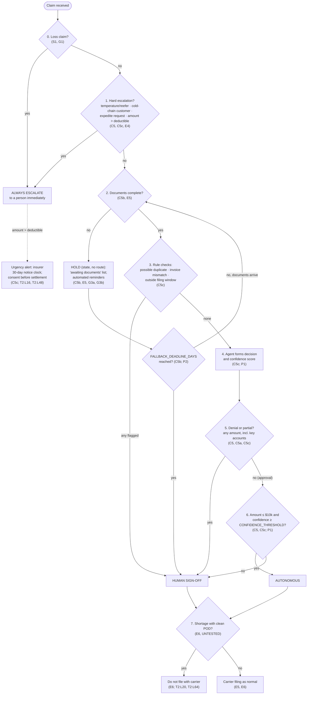

# Decision Tree: Claims Agent Routing

> Fictional engagement for portfolio purposes. The client, stakeholders and data are synthetic.

Every element cites a ruling in `docs/consultant-decisions.md` or a source.
Open gaps are listed in `open-gaps.md`.

**Thresholds and parameters**
- $10k: provisional (C2, C5; D3).
- Deductible: assumed $25k until the CFO confirms it (D1; T2:L16).
- `CONFIDENCE_THRESHOLD`: unset; to be calibrated in the Day 2 eval (P1).
- `FALLBACK_DEADLINE_DAYS`: unset; to be set in requirements v1 (P2).

**Precedence (G2):** the first step that matches decides. This gives
always escalate > hold > human sign-off > autonomous. **Hold is a state, not a
route (G3a)**, and applies at every amount (G3b).

Step 7 is an action on paid claims, not a route. It applies after either an
autonomous or a signed-off approval.

## Rule table

| Step | Check | If true | If false | Ruling | Citation |
|---|---|---|---|---|---|
| 0 | Loss claim | Always escalate | Step 1 | S1, G1 | T2:L50 |
| 1 | Temperature/reefer claim | Always escalate | Next check | C5 | T2:L44, T2:L58 |
| 1 | Cold-chain contract customer | Always escalate | Next check | C5c | T2:L44 |
| 1 | Account-manager expedite request | Always escalate | Next check | C5, E4 | T1:L10, T2:L14 |
| 1 | Amount above the deductible | Always escalate, with insurer clock alert | Step 2 | C5 | T2:L16, T2:L48; Q7, Q12 |
| 2 | Documents complete (any amount) | Step 3 | Hold (state, no route) and remind; at `FALLBACK_DEADLINE_DAYS` → human sign-off | C5b, E5, G3a, G3b | T2:L30, T2:L34; Q11, Q13 |
| 3 | Possible duplicate (same shipment or claim already paid) | Human sign-off | Next check | C5c | T2:L68 |
| 3 | Claimed amount does not match the invoice | Human sign-off | Next check | C5c | T2:L42 |
| 3 | Outside the customer filing window | Human sign-off | Step 4 | C5c | Q14 |
| 4 | Agent forms decision (approve, partial, deny) and confidence score | — | — | C5c | P1 |
| 5 | Decision is denial or partial (any amount, key accounts included) | Human sign-off | Step 6 | C5, C5a, C5c | T1:L36, T2:L16, T2:L58; Q14 |
| 6 | Approval at or below $10k with confidence ≥ `CONFIDENCE_THRESHOLD` | Autonomous | Human sign-off | C5, C5c | T2:L14, T2:L62; Q8 |
| 7 | Shortage with clean POD (paid claims) | Do not file with carrier | Carrier filing as normal | E6 (UNTESTED) | T2:L20, T2:L64; Q10 |

## Escalation triggers

Each one routes to **always escalate**.

| # | Trigger | Why | Ruling | Citation |
|---|---|---|---|---|
| T1 | Temperature/reefer claim, at intake | Download kept ~72h; must be requested the same day; cannot wait in a queue | C5 | T2:L44, T2:L58 |
| T2 | Cold-chain contract customer | Northline is liable under contract terms regardless of the carrier | C5c | T2:L44 |
| T3 | Account-manager expedite request | Commercial urgency handled by an accountable person; never auto-approved | C5, C4, E4 | T1:L10, T2:L14, T2:L54 |
| T4 | Amount above the deductible (assumed $25k) | Insurer notice within 30 days and consent before settlement | C5 | T2:L16, T2:L48, T2:L62; Q12 |
| T5 | Loss claim (step 0) | Outside the agent pilot; the agent forms no decision | S1, G1 | T2:L50 |

## Human sign-off triggers

| # | Trigger | Ruling | Citation |
|---|---|---|---|
| H1 | Documents incomplete at `FALLBACK_DEADLINE_DAYS` | C5b | T2:L30, T2:L34; Q11 |
| H2 | Possible duplicate | C5c | T2:L68 |
| H3 | Invoice mismatch | C5c | T2:L42 |
| H4 | Outside customer filing window | C5c | Q14 |
| H5 | Any denial | C5 | T1:L36, T2:L16, T2:L58 |
| H6 | Partial at or below $10k (and above, via H7) | C5a | T1:L36; Q14 |
| H7 | Amount above $10k, at or below the deductible | C5 | T2:L14, T2:L62; Q8 |
| H8 | Key-account denial or partial | C5c | T1:L10, T1:L36 |
| H9 | Confidence below `CONFIDENCE_THRESHOLD` | C5c | P1 |

## Urgency alert (not a route)

**Insurer 30-day notice clock.** On every escalated claim above the
deductible, the agent raises an alert showing days remaining to notify the
insurer, and that consent is needed before settlement. It does not change the
route (C5c; T2:L16, T2:L48; Q12).
