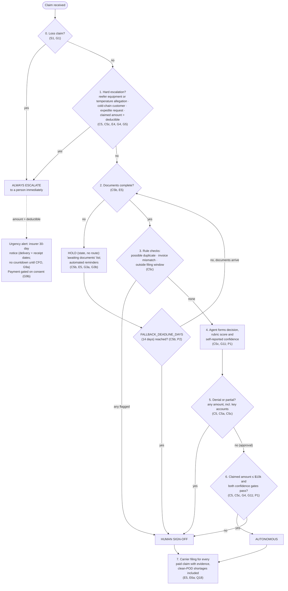

# Decision Tree: Claims Agent Routing

> Fictional engagement for portfolio purposes. The client, stakeholders and data are synthetic.

Every element cites a ruling in `docs/consultant-decisions.md` or a source.
Open gaps are listed in `open-gaps.md`.

**Thresholds and parameters**
- $10k: provisional (C2, C5; D3).
- Deductible: assumed $25k until the CFO confirms it (D1; T2:L16).
- Both thresholds are measured on the claimed amount (G4).
- `CONFIDENCE_THRESHOLD`: two thresholds, rubric score and self-reported confidence; both must pass (G11). Unset; calibrated in the Day 2 eval (P1).
- `FALLBACK_DEADLINE_DAYS`: 14 calendar days from receipt (P2; Q19).

**Precedence (G2):** the first step that matches decides. This gives
always escalate > hold > human sign-off > autonomous. **Hold is a state, not a
route (G3a)**, and applies at every amount (G3b).

Step 7 is an action on paid claims, not a route. It applies after either an
autonomous or a signed-off approval.

## Rule table

| Step | Check | If true | If false | Ruling | Citation |
|---|---|---|---|---|---|
| 0 | Loss claim | Always escalate | Step 1 | S1, G1 | T2:L50 |
| 1 | Reefer equipment (`reefer_flag` = Y) or temperature-excursion allegation | Always escalate | Next check | C5, G5 | T2:L44, T2:L58; Q16 |
| 1 | Cold-chain contract customer | Always escalate | Next check | C5c | T2:L44 |
| 1 | Account-manager expedite request | Always escalate | Next check | C5, E4 | T1:L10, T2:L14 |
| 1 | Claimed amount above the deductible | Always escalate, with insurer clock alert | Step 2 | C5, G4 | T2:L16, T2:L48; Q7, Q12, Q15 |
| 2 | Documents complete (any amount) | Step 3 | Hold (state, no route) and remind; at `FALLBACK_DEADLINE_DAYS` → human sign-off | C5b, E5, G3a, G3b | T2:L30, T2:L34; Q11, Q13 |
| 3 | Possible duplicate (same shipment or claim already paid) | Human sign-off | Next check | C5c | T2:L68 |
| 3 | Claimed amount does not match the invoice | Human sign-off | Next check | C5c | T2:L42 |
| 3 | Outside the customer filing window | Human sign-off | Step 4 | C5c | Q14 |
| 4 | Agent forms decision (approve, partial, deny), rubric score and self-reported confidence | — | — | C5c, G11 | P1 |
| 5 | Decision is denial or partial (any amount, key accounts included) | Human sign-off | Step 6 | C5, C5a, C5c | T1:L36, T2:L16, T2:L58; Q14 |
| 6 | Approval, claimed amount at or below $10k, with confidence ≥ `CONFIDENCE_THRESHOLD` | Autonomous | Human sign-off | C5, C5c, G4 | T2:L14, T2:L62; Q8 |
| 7 | Paid claim with evidence (clean-POD shortages included) | Carrier filing | — | E5, E6a | T2:L20, T2:L64; Q10, Q18 |

## Escalation triggers

Each one routes to **always escalate**.

| # | Trigger | Why | Ruling | Citation |
|---|---|---|---|---|
| T1 | Reefer equipment or temperature-excursion allegation, at intake | Download kept ~72h; must be requested the same day; cannot wait in a queue | C5, G5 | T2:L44, T2:L58; Q16 |
| T2 | Cold-chain contract customer | Northline is liable under contract terms regardless of the carrier | C5c | T2:L44 |
| T3 | Account-manager expedite request | Commercial urgency handled by an accountable person; never auto-approved | C5, C4, E4 | T1:L10, T2:L14, T2:L54 |
| T4 | Claimed amount above the deductible (assumed $25k) | Insurer notice within 30 days and consent before settlement | C5 | T2:L16, T2:L48, T2:L62; Q12 |
| T5 | Loss claim (step 0) | Outside the agent pilot; the agent forms no decision | S1, G1 | T2:L50 |

## Human sign-off triggers

| # | Trigger | Ruling | Citation |
|---|---|---|---|
| H1 | Documents incomplete at `FALLBACK_DEADLINE_DAYS` | C5b | T2:L30, T2:L34; Q11 |
| H2 | Possible duplicate | C5c | T2:L68 |
| H3 | Invoice mismatch | C5c | T2:L42 |
| H4 | Outside customer filing window | C5c | Q14 |
| H5 | Any denial | C5 | T1:L36, T2:L16, T2:L58 |
| H6 | Partial at or below $10k (and above, via H7) | C5a | T1:L36; Q14 |
| H7 | Claimed amount above $10k, at or below the deductible | C5, G4 | T2:L14, T2:L62; Q8 |
| H8 | *Removed from routing (G6).* Key-account denials and partials reach sign-off through H5–H7; key accounts get queue priority and account-manager notice instead | C5c, G6 | T1:L10, T1:L36 |
| H9 | Either confidence gate fails (rubric or self-report below its threshold) | C5c, G11 | P1 |

## Duplicate flag at intake

The duplicate check runs at intake and raises a flag that specialists see on
the "awaiting documents" list. Routing on the flag stays at step 3 (G13).

## Re-routing and withdrawals

New information re-runs the tree, and a claim moves only up (G10a). Escalated
claims are never handed back (G10b). Withdrawn claims take a `withdrawn`
status with no route, unless a payment was made, in which case they go to
human sign-off (G12). Detail: `scope-table.md`, "Re-routing and withdrawals".

## Operations by tier

What the agent produces in each tier, who works it and the response time are
set out in `scope-table.md` ("Operations by tier"; G7a–G7e).

## Urgency alert (not a route)

**Insurer 30-day notice clock.** On every escalated claim above the
deductible, the agent raises an alert showing the delivery date and the
receipt date. It shows no countdown until the CFO confirms when the 30 days
start (G9a; Q17). It does not change the route (C5c; T2:L16, T2:L48; Q12).

**Consent gate (G9b).** No payment instruction can be issued on a claim above
the deductible until insurer consent is recorded on the claim (T2:L16; Q12).
