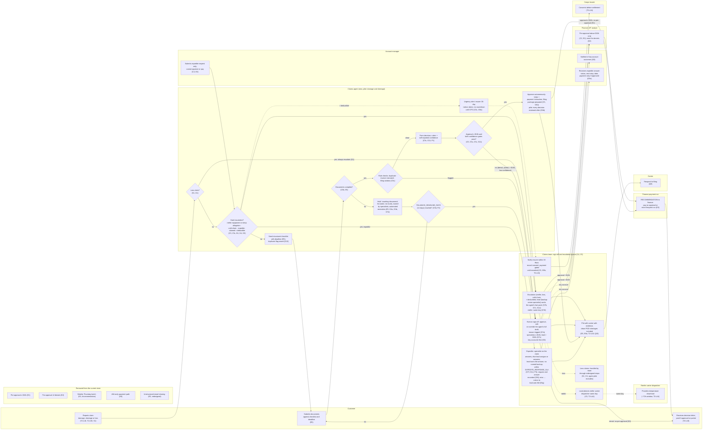

# Future-State Swimlane: Claims Process with Agent

> Fictional engagement for portfolio purposes. The client, stakeholders and data are synthetic.

Every element cites a ruling in `docs/consultant-decisions.md` or a source.
Routing detail is in `decision-tree.md` and `scope-table.md`. Open gaps are
listed in `open-gaps.md`.

The redesign applies to all claim types, because loss claims share the
process (S1; T2:L50). The agent pilot handles damage and shortage only; the
agent escalates loss claims at step 0, and the claims team handles them
through the same redesigned steps (S1, G1).

## Notes

- **Every E ruling is visible:** E1 to E4 as changes and in the "Removed"
  lane, E5 at intake. E6 was reversed by E6a (Q18): clean-POD shortages are
  filed with the carrier.
- **E3 is a recommendation to finance**, not an agent step (E3).
- **Account managers** only submit expedite requests, which always escalate
  (C4, E4; ratified, D5 closed). The answer comes within
  `EXPEDITE_RESPONSE_SLA` from the specialist on the claim or the lead
  (G7f, G14, P3), and may promise payment only on an approved claim (D5e).
- **Insurer consent** is a hard gate: no payment instruction on a claim above
  the deductible until consent is recorded (G9b). The 30-day clock start is
  unset until the CFO confirms it (G9a).
- **On the autonomous route** the agent sends the letter and the payment
  instruction, and prepares the carrier filing for a specialist to submit
  (G8a). During the pilot, every autonomous decision is reviewed after it is
  made (G8b).
- **Re-routing:** new information moves a claim up a tier, never down;
  escalated claims are never handed back (G10a, G10b). Withdrawals take a
  `withdrawn` status, or go to sign-off if a payment was made (G12).
