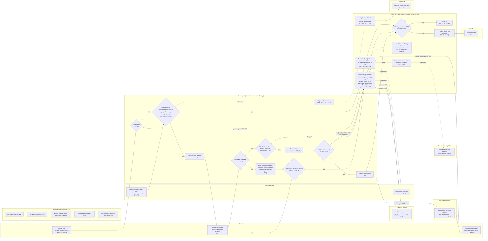

# Future-State Swimlane: Claims Process with Agent

> Fictional engagement for portfolio purposes. The client, stakeholders and data are synthetic.

Every element cites a ruling in `docs/consultant-decisions.md` or a source.
Routing detail is in `decision-tree.md` and `scope-table.md`. Open gaps are
listed in `open-gaps.md`.

The redesign applies to all claim types, because loss claims share the
process (S1; T2:L50). The agent pilot handles damage and shortage only; the
agent escalates loss claims at step 0, and the claims team handles them
through the same redesigned steps (S1, G1).

## Notes

- **Every E ruling is visible:** E1 to E4 as changes and in the "Removed"
  lane, E5 at intake, E6 at carrier filing (marked UNTESTED).
- **E3 is a recommendation to finance**, not an agent step (E3).
- **Account managers** only submit expedite requests, which always escalate
  (C4, E4). C4 and E4 still need the COO's ratification (D5).
- **Insurer consent** must be obtained before payment on claims above the
  deductible. The diagram shows the insurer step but not a gate on the
  payment edge; see `open-gaps.md` G9.
- **Carrier filing, letters and payment instructions** are drawn with the
  claims team, as today, except for the autonomous route. Which of these the
  agent performs is not ruled; see `open-gaps.md` G8.
