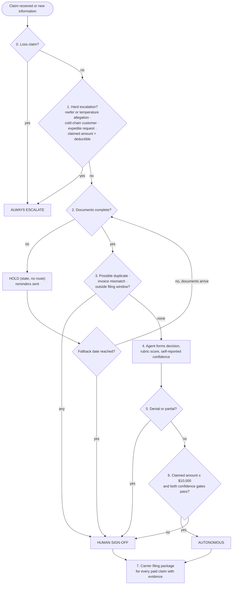

# Decision Rules

> Fictional engagement for portfolio purposes. The client, stakeholders and data are synthetic.

This file governs. The agent must apply these rules exactly and must never
decide outside the scope table. Anything outside it goes to `escalate`.

## Precedence

- The decision tree runs in step order. **The first step that matches decides** (`G2`).
- This gives: always escalate > hold > human sign-off > autonomous.
- Scope-table rows are not mutually exclusive. When a claim matches several rows, the highest tier wins.
- At step 1, the agent must evaluate **every** trigger and list all that fired in the fact pack. `rule_applied` is the first row that fired, in table order.
- At step 3, the agent must evaluate every check and list all flags raised. `rule_applied` is the first row that fired.

## Decision tree

Step 7 is an action on paid claims, not a route.

## Rule table

| Step | Check | If true | If false | Ruling |
|---|---|---|---|---|
| 0 | `claim_type` = loss | Escalate (R16). No decision. Step-1 triggers are still evaluated and listed in `triggers` and the fact pack; they do not change the route | Step 1 | S1, G1 |
| 1 | `reefer_flag` = Y, or the claim alleges a temperature excursion | Escalate (R1) | Next check | C5, G5 |
| 1 | Customer is on the cold-chain list | Escalate (R2) | Next check | C5c |
| 1 | An expedite request has been made on the claim | Escalate (R3) | Next check | C4, E4 |
| 1 | Claimed amount > deductible | Escalate (R4), with insurer alert | Step 2 | C5, G4 |
| 2 | Documents complete for the claim type | Step 3 | Hold (R5). At the fallback date: sign-off (R6) | C5b, E5, E5a, G3a, G3b |
| 3 | Possible duplicate | Sign-off (R7) | Next check | C5c, G13 |
| 3 | Invoice mismatch | Sign-off (R8) | Next check | C5c |
| 3 | Outside the filing window | Sign-off (R9) | Step 4 | C5c |
| 4 | Agent forms `decision`, `rubric_score`, `self_reported_confidence` | — | — | G11 |
| 5 | Decision is `deny` | Sign-off (R10) | Next check | C5 |
| 5 | Decision is `partial` | Sign-off (R11 at or below $10,000; R13 above) | Step 6 | C5a |
| 6 | Claimed amount > $10,000 | Sign-off (R13) | Next check | C5, G4 |
| 6 | Either confidence gate fails | Sign-off (R14) | Autonomous (R15) | G11 |
| 7 | Claim paid and documents complete | Agent prepares carrier filing package; specialist submits | No package | G8a, E6a |

### Definitions used by the checks

**Temperature allegation (step 1).** Any statement in the claim or its
documents that goods were exposed to a temperature outside their required
range, arrived warm, thawed or frozen, or spoiled because of temperature. It
applies whether or not `reefer_flag` is Y (`G5`). If the agent is unsure
whether a statement is an allegation, it must treat it as one.

**Cold-chain list (step 1).** A list of customer IDs whose contracts make
Northline liable for a temperature excursion regardless of the carrier. The
claims lead maintains it. It starts with the three customers named by the
claims lead: Copperwick Foods, Asterholm Medical Supply and Pinehallow
Gourmet. Their customer IDs must be added before go-live (D12). The pilot
must not go live with an empty list.

**Expedite request (step 1).** A request from an account manager, recorded
on the claim with the requester and the request time. Once made, it is a step-1 trigger on every
later evaluation, whether or not it has been answered. Answering it closes
the SLA clock only.

**Documents complete (step 2).** Every item on the checklist for the claim
type has been received (`E5a`). The agent applies this checklist, not any
completion date entered by a person.

| Claim type | Required documents |
|---|---|
| Damage | Photos, invoice, BOL, delivery receipt/POD |
| Shortage | Invoice, BOL, delivery receipt/POD. Photos are optional |
| Damage or shortage with a temperature allegation or `reefer_flag` = Y | The list above, plus the reefer temperature download. (These claims escalate at step 1, so the checklist status goes in the fact pack.) |
| Loss | Not applicable (escalated at step 0) |

**Possible duplicate (step 3).** Another claim, of any type, has the same
`shipment_ref` and has been paid or is still open (`G13`). The check also
runs at intake and raises the flag on the "awaiting documents" list, but it
changes the route only at step 3.

**Invoice mismatch (step 3).** The claimed amount is greater than the
invoice amount for the claimed goods, compared to the cent, or the invoice
amount cannot be read from the invoice. A claimed amount below the invoice
amount is not a mismatch (a claim may cover part of a shipment).

**Outside the filing window (step 3).** The number of calendar days from the
delivery date to the receipt date is greater than `FILING_WINDOW_DAYS`.

**Fallback date (step 2).** Receipt date + `FALLBACK_DEADLINE_DAYS`. The check
runs at 23:59 ET on the fallback date. Documents received at or before that
time count as complete.

## Scope table

| # | Condition | Tier | Rationale | Ruling |
|---|---|---|---|---|
| R1 | Reefer equipment or temperature allegation | Always escalate | The temperature download is kept about 72 hours and must be requested the same day | C5, G5 |
| R2 | Cold-chain customer | Always escalate | Contract liability regardless of the carrier | C5c |
| R3 | Expedite request | Always escalate | Commercial urgency goes to an accountable person; never auto-approved | C4, E4 |
| R4 | Claimed amount above the deductible | Always escalate | Insurer notice within 30 days and consent before settlement | C5 |
| R5 | Documents incomplete, before the fallback date, any amount | Hold (state, no route) | The agent never decides on incomplete documents | C5b, G3a, G3b |
| R6 | Documents incomplete at the fallback date | Human sign-off | A fixed point that goes to a person | C5b, P2 |
| R7 | Possible duplicate | Human sign-off | Duplicate payments have happened | C5c |
| R8 | Invoice mismatch | Human sign-off | The invoice is the value the team works from | C5c |
| R9 | Outside the filing window | Human sign-off | A denial reason; denials go to a person | C5c |
| R10 | Denial, any amount | Human sign-off | A person makes every denial | C5 |
| R11 | Partial at or below $10,000 | Human sign-off | A partial is a partial denial | C5a |
| R12 | *Removed.* Key-account status does not change the route | — | Key-account denials and partials reach a person through R10, R11 and R13 | G6 |
| R13 | Claimed amount above $10,000, at or below the deductible | Human sign-off | The existing specialist/lead approval line | C5 |
| R14 | Either confidence gate fails | Human sign-off | Doubt from either signal sends the claim to a person | G11 |
| R15 | Damage or shortage approval, claimed amount at or below $10,000, documents complete, no flags, both gates pass | Autonomous | Routine, documented, low-value approvals | C5, C5b, C5c |
| R16 | Loss claim | Always escalate | Outside the pilot | S1, G1 |

### Operations by tier

| Tier | Agent produces | Who works it | Response time |
|---|---|---|---|
| Autonomous | Decision, customer letter, payment instruction to finance (no pre-approval). Carrier filing package for step 7 | Specialist submits the carrier filing. The autonomous reviewer reviews every decision after it is made | — |
| Human sign-off | Full draft: decision, amount, rule applied, rationale, customer letter | Specialists: claimed amount ≤ $10,000. Claims lead: > $10,000 | No target in v1 |
| Escalate: expedite request | Fact pack | See "Expedite requests" below | `EXPEDITE_RESPONSE_SLA` |
| Escalate: reefer/temperature (R1 among the triggers, loss claims included) | Fact pack, leading with the 72-hour download clock | Claims lead; senior specialist as backup | Picked up on the day of receipt |
| Escalate: loss, cold-chain, above the deductible | Fact pack; insurer dates where above the deductible | Claims lead; senior specialist as backup | No target in v1 |
| Hold | Reminders; release at completion or the fallback date | Specialists own the "awaiting documents" list | — |

Within the sign-off and escalation queues, key-account claims are worked
first (`G6`).

### Expedite requests

| Item | Rule |
|---|---|
| Route | Always escalate (R3). Never decided by the agent |
| Who answers | The specialist already working the claim. If no one is, the claims lead assigns it or answers |
| Who owns the on-time answer | The claims lead. No named backup for expedite answers |
| Who decides the claim | If the expedite request is the **only** escalation trigger: specialists at or below $10,000, the claims lead above. If any other trigger also fired: the claims lead |
| Deadline | `EXPEDITE_RESPONSE_SLA` |
| What the answer may say | Current status, next step, and the expected date where known. A payment commitment only on a claim the claims team has already approved (for example, "approved, payment going out [date]"). No commitment before a decision, before documents are complete, or before insurer consent where required |
| Record | Request time, answer time, answer content, outcome |
| SLA missed | Automatic notice to the claims lead and the requesting account manager. Nothing goes to anyone else |

### After the decision

| Situation | Rule | Ruling |
|---|---|---|
| Approval or partial, claimed amount ≤ $10,000 | No finance pre-approval. Payment instruction goes to finance | E1 |
| Approval or partial, claimed amount > $10,000 | Finance pre-approval before payment | C2 |
| Denial | No finance pre-approval. The denial letter is sent after sign-off | E2 |
| Claimed amount > deductible | **No payment instruction until insurer consent is recorded on the claim.** The claims lead records it | G9b |
| Claimed amount > deductible, escalated | Insurer alert in the fact pack: delivery date and receipt date. No countdown | G9a |
| Paid claim, documents complete | Carrier filing package prepared for every such claim, clean-POD shortages included. A clean POD is not a bar to filing | G8a, E6a |
| Paid claim, documents incomplete (paid after the fallback) | No package. The person who signed off may file manually | G8a |
| Key-account claim decided | Account manager notified of the outcome. The notice carries no approval or payment rights | G6 |

### Re-routing, withdrawals

| Event | Effect | Ruling |
|---|---|---|
| New information before a decision (expedite request, documents, a new flag) | Re-run the tree from step 0. The claim may move up a tier, never down | G10a |
| New information on a claim already with a person | Stays with that person, who sees the new information | G10a |
| New information after an autonomous decision | Human sign-off, or escalate if the re-run fires a step-1 trigger | G10a |
| Escalated claim turns out to be simple | No handback. A person finishes it | G10b |
| Customer withdraws, nothing paid | `status` = `withdrawn`, with date and reason. Leaves any hold or queue. No route | G12 |
| Customer withdraws, payment already made | Human sign-off | G12 |

## Confidence gates

Two gates (`G11`). **Both must pass** for the autonomous tier. If either
fails, the claim goes to human sign-off (R14). They are never combined.

### Gate 1: rubric score

A fixed checklist. The agent answers each item `pass` or `fail` from the
claim and its documents. `rubric_score` = passed items ÷ 6, rounded to two
decimals. The per-item results go in the trace.

| # | Item | Pass when |
|---|---|---|
| RB1 | Shipment match | The claimed goods appear on the BOL and the shipment record for this `shipment_ref` |
| RB2 | Loss evidenced | Damage: the photos show damage to the claimed goods. Shortage: the BOL or delivery receipt shows fewer units delivered than shipped, or the customer's count is consistent with the documents |
| RB3 | Amount supported | The claimed amount equals the invoice value of the claimed goods (to the cent) |
| RB4 | No reduction indicated | Nothing in the documents indicates salvage value, depreciation, or a pre-existing condition that would reduce the payout |
| RB5 | Documents consistent | Dates, quantities and references agree across the claim and its documents |
| RB6 | Rule traceable | The decision follows from a single row of the scope table, named in `rule_applied` |

### Gate 2: self-reported confidence

The model's own confidence, from 0 to 1, that its decision is correct.

### Thresholds

- `RUBRIC_SCORE_THRESHOLD`: **1.00** for the pilot (every rubric item must pass).
- `SELF_REPORTED_CONFIDENCE_THRESHOLD`: **0.80**, provisional. It is recalibrated from the eval: the threshold is set where the self-report best separates correct from incorrect decisions.

## Parameters

| Parameter | Value | Status |
|---|---|---|
| $10,000 line | 10,000, on the claimed amount | Assumption A2 |
| Deductible | 25,000, on the claimed amount | Assumption A1 |
| `FALLBACK_DEADLINE_DAYS` | 14 calendar days from receipt | Set (P2) |
| `FILING_WINDOW_DAYS` | 270 calendar days, delivery date to receipt date | Assumption A5 |
| `REMINDER_DAYS` | Reminders on days 3, 7 and 11 after receipt. The day-11 reminder states the fallback date | Set in v1 |
| `RUBRIC_SCORE_THRESHOLD` | 1.00 | Pilot value |
| `SELF_REPORTED_CONFIDENCE_THRESHOLD` | 0.80 | Provisional; recalibrated from the eval |
| `EXPEDITE_RESPONSE_SLA` | Business days, ET. Request before 14:00 → answer by 17:00 the same business day. Request at or after 14:00, or on a non-business day → answer by 12:00 the next business day | Provisional (P3, P3a) |
| Business day | Monday to Friday, excluding company holidays | Assumptions A3, A4 |

The checklist request (with the fallback date) is sent on the day of receipt
(day 0). A reminder lists only the items still missing. No reminder is sent
once documents are complete or the claim leaves the hold.

## Agent input

What the agent receives at each evaluation (`G23`). An evaluation sees only
what is known at its evaluation time: no later document, outcome, payment or
recovery.

| Field | Type | Contents |
|---|---|---|
| `evaluation_time` | datetime (ET) | When this evaluation runs |
| `event` | enum | `received`, `documents_updated`, `expedite_request`, `withdrawal`, `fallback_check` |
| `claim_id` | string | The claim's ID |
| `claim_type` | enum | `damage`, `shortage`, `loss` |
| `customer_id` | string | Matched against the cold-chain list |
| `key_account` | boolean | Queue priority only (`G6`) |
| `shipment_ref` | string | Used for the duplicate check |
| `amount_claimed` | number | All thresholds use this amount (`G4`) |
| `delivered_at`, `received_at` | date | Delivery date and claim receipt date. A missing delivery date is outside the filing window (R9) |
| `reefer_flag` | boolean | Shipment ran on reefer equipment |
| `pod_exception` | boolean | True if the delivery receipt/POD notes an exception |
| `claim_text` | string | The customer's statement of the claim. Checked for a temperature allegation |
| `documents` | list | Each checklist item received so far: item, received date and its content (photos, invoice with `invoice_amount`, BOL, delivery receipt/POD, temperature download) |
| `shipment_record` | object or null | Items and quantities shipped under the `shipment_ref`, if held. Used by RB1 |
| `other_claims_same_shipment` | list | Every other claim with the same `shipment_ref`: claim ID and status (`open`, `paid`, `closed_unpaid`) |
| `cold_chain_list` | list | Customer IDs on the cold-chain list |
| `expedite_requests` | list | Each request: requester and request time |
| `current_state` | object | Current `status`, `route`, assigned person or queue, and whether an autonomous decision has been made |
| `paid` | boolean | Whether any payment has been made on this claim |
| `withdrawal` | object or null | Withdrawal date and reason |

## Agent output

One record per claim per evaluation (`G17`).

| Field | Type | Values and rules |
|---|---|---|
| `claim_id` | string | The claim's ID |
| `status` | enum | `held`, `routed`, `withdrawn` |
| `route` | enum or null | `autonomous`, `sign_off`, `escalate`. **Null when `status` is `held` or `withdrawn`** |
| `decision` | enum or null | `approve`, `partial`, `deny`. **Null on `escalate`, `held` and `withdrawn`**. On `sign_off` it is the agent's draft |
| `amount` | number or null | Proposed payout. Null whenever `decision` is null or `deny` |
| `rule_applied` | string | The scope-table row that set the outcome: `R1`–`R16`. `R5` on a hold. `G12` on a withdrawal |
| `triggers` | list | Every step-1 trigger and step-3 flag that fired (for example `["R1","R3"]`). Empty if none |
| `rubric_score` | number or null | 0–1, two decimals. Null if step 4 was not reached |
| `rubric_items` | object or null | `RB1`–`RB6`, each `pass` or `fail`. Null if step 4 was not reached |
| `self_reported_confidence` | number or null | 0–1. Null if step 4 was not reached |
| `rationale` | string | Plain language. Cites the documents and the rule |
| `hold` | object or null | Required when `status` = `held`, otherwise null. See below |
| `fact_pack` | object or null | Required when `route` = `escalate`, otherwise null. See below |

**Step 4 on sign-off claims.** When a claim reaches sign-off at step 2 (R6)
or step 3 (R7–R9), the agent still forms a draft decision, amount and
rationale for the person (`G7a`). `rubric_score` and
`self_reported_confidence` are filled where step 4 ran.

### Hold status field (`G18`)

| Field | Type | Values |
|---|---|---|
| `hold_reason` | enum | `awaiting_documents` |
| `missing_items` | list | Checklist items not yet received |
| `reminders_sent` | list of dates | Dates each reminder went out, including the day-0 request |
| `fallback_date` | date | Receipt date + `FALLBACK_DEADLINE_DAYS` |
| `duplicate_flag` | boolean | True if the intake duplicate check fired (`G13`) |

### Fact pack

| Field | Contents |
|---|---|
| `triggers` | Every trigger that fired, in table order |
| `checklist_status` | Each required document, received or missing |
| `clocks` | Reefer: receipt date and time, with "temperature download must be requested today". Above the deductible: delivery date and receipt date (no countdown) |
| `expedite` | Requester, request time, answer due time (when R3 fired) |
| `queue` | `claims_lead`, or `specialist` (expedite-only, claimed amount ≤ $10,000) |
| `key_account` | True or false (queue priority only) |
